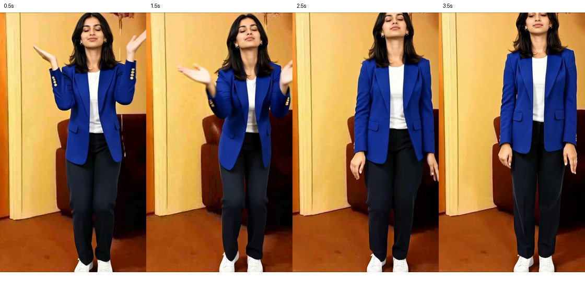

# 从动作参考到4秒人物片：一个可复核的样例

[返回README](README.md) · [观看实测输出](demo.mp4)

## 输入与目标

- 参考：《Simple step demo》，Secarver7，CC BY 3.0。原片约3.84秒、1280×720；本例转码、补末帧至4.00秒，并加入静音AAC。
- 目标：为本例生成的虚构成年人物图，蓝色西装、白内搭、深裤、白鞋。侧脸与背面没有图片依据。
- 保留：参考动作顺序、主要抬手/落手事件与停顿。
- 不保证：面部逐像素一致、每帧足部轨迹、复杂舞步或声音复刻。

## 动作如何写清楚

左右统一以人物自身为准，朝镜头时与画面左右相反。原方案结合较密抽帧记录了下列近似事件：

| 参考相对时间 | 可见动作事件 | 交接重点 |
|---|---|---|
| 0–0.40s | 双手从腰胸向两侧上提，小步过渡 | 清楚起势，保留头顶与手势空间 |
| 0.40–0.80s | 双掌向身体中线相合，再分开 | 第一处合掌与动作方向 |
| 0.80–1.27s | 左膝抬起，手下扫后回落 | 支撑腿、遮挡与动作幅度 |
| 1.27–1.74s | 双脚靠近、开掌后再次合掌 | 第二处合掌的先后关系 |
| 1.74–2.30s | 右膝抬起、回落 | 左右基准一致，不把镜像误作正确 |
| 2.30–3.84s | 收势站定，手臂垂下 | 留出稳定结束姿态 |

上表是参考观察与计划，不代表生成片逐一完整复现。实际验收只支持主要举手/落手顺序；步伐与幅度仍部分符合。

## 实际用的应用与参数

使用[中国站替代APP](https://www.runninghub.cn/ai-detail/2063185999106236418)，不是国际站默认APP。

| 字段 | 样例值 |
|---|---|
| 原视频 | reference.mp4（本仓库为带静音AAC兼容版） |
| 要替换的模特图 | target-person.png |
| 参考视频的帧率 | 30 |
| 跳过秒数 | 0 |
| 总时长 | 4 |
| 要换视频里哪个物体 | 整个人 |
| 宽度/高度 | 当时默认720/1280 |

应用没有普通动作提示词字段，导演文本留在方案和验收中。不要把它塞进“自定义物体名称”。

## 一次明确的兼容性修复

较早任务用无音轨视频，在`Audio Duration (mtb)`访问`audio["waveform"]`时报`KeyError: waveform`。工作流需要音频时长数据，只有视频轨不足以满足该节点。

兼容输入保持原动作，转为30fps H.264；片尾延长约0.16秒到4.00秒，补48kHz双声道静音AAC。随后Plus任务成功输出4秒720×1280视频。

这是对这组输入和特定工作流的实测修复，不是所有任务失败都应该加静音，也不代表新增加了声音复刻能力。

## 实际验收

接触表采样0.5、1.5、2.5、3.5秒。蓝色外套与服装配色连续，主要举手和落手时段接近参考；面部细节、体态、细微步伐只部分符合。采样不能排除所有中间帧的手指、遮挡恢复或动作问题。

生成运行07:10，前后页面积分差约98.90，没有逐任务账单。原国际站APP未运行，真实同事独立接手尚待验收。本次发布不重新生成，不追加云端费用。

## 素材出处

所有动作参考及派生展示的来源、署名和修改见[ATTRIBUTION.md](ATTRIBUTION.md)。不表示原作者为本项目或生成服务背书。
