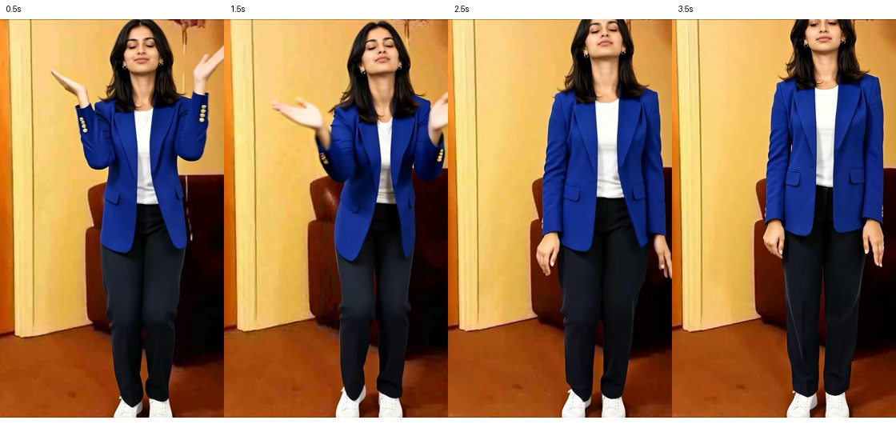

# 人物动作复刻导演助手

### 把“让这个人照着做”，变成有依据、能交接、可验收的制作方案。

**person-video-remake** 将参考动作、目标人物形象和运营要求，整理成动作时间表、身份约束、分镜提示词、RunningHub字段交接和成片验收清单。适合虚构角色演示、获授权的模特视频重构与人物短片制作。



**[观看4秒实测视频](https://github.com/ultimatech-cn/person-video-remake/raw/refs/heads/main/demo.mp4)** · **[下载Skill](https://github.com/ultimatech-cn/person-video-remake/releases/latest)** · [案例详解](EXAMPLE.md) · [Skill指令入口](SKILL.md)

> 参考不是一句“模仿它”，而是可定位的起势、方向、幅度、停顿与结束姿态。脚本或APP生成画面，Skill帮助Agent把这些要求说清楚、交接准确、逐项核对。

## 你会得到什么

| 制作环节 | 本Skill的价值 | 可交付内容 |
|---|---|---|
| 看懂参考 | 拆解动作事件、机位、遮挡与停顿，统一左右方向基准 | 带时间依据的动作表 |
| 锁定人物 | 区分身份特征、服装与允许改变的造型 | 发型/服装/可见面部特征核对表 |
| 写清要求 | 按主体、动作顺序、机位、场景与节奏组织文本 | 逐镜提示词与外观约束 |
| 交给运营 | 用实际APP字段交接素材，不虚构输入框 | 上传文件与参数映射表 |
| 拿到结果 | 分开检查人物、动作、节奏、手脚与声音 | 问题时间点、结论与重跑建议 |

这是一项**Agent参与的导演与验收工作流**，不是独立视频模型、无限制换脸工具或全自动生成客户端。需要执行云端时，由APP完成生成；Agent操作网页需有授权与可用工具。

## 看一个真实跑过的例子

输入一段简单步伐参考，以及为演示生成的**虚构成年人物**：齐肩深发、蓝色外套、白内搭、深色长裤和白鞋。输出4秒、720×1280的人物视频。

- 中国站替代APP确实完成了上传、生成、下载与本地解码。
- 主要举手→落手事件与参考时间段接近；服装配色保持可辨。
- 面部细节和体态仅部分一致，细微步伐不够突出；没有宣称逐帧动作轨迹一致。
- 输入原本无音轨，工作流报`KeyError: waveform`；加入静音AAC兼容轨后，同一组素材成功出片。

[完整案例与修复过程](EXAMPLE.md)包含结果、限制和时间依据。动作参考由Secarver7创作，采用CC BY 3.0；出处、修改说明和适配输出的署名见[素材说明](ATTRIBUTION.md)。

## 什么场景适合用

- **人物短片策划**：把参考动作整理成可复核的动作事件，而非空泛地要求“动作一样”。
- **虚构角色演示**：使用虚构成年人物图，尝试保留参考节奏和服装识别点。
- **运营素材交接**：明确哪个文件放哪个字段，减少提示词与APP能力错配。
- **失败诊断与审片**：把音轨兼容、动作不足、人物漂移等问题分别定位。

目标人物应有覆盖生成与预期分享用途的授权；无授权时可先分析参考，待补齐授权后使用人物素材。不将可见照片自动视为有肖像使用许可。

## 两个APP入口，字段不要混用

字段是**2026-11-13历史核验快照**；实际运行前重新查看页面与费用。

| 路线 | 输入字段 | 历史验证 |
|---|---|---|
| [Instagram Influencer Video Recreation](https://www.runninghub.ai/zh-cn/AI-DETAIL/2093879380232998913) | `Reference video`、`image`、`Supplementary prompts` | 核对过公开字段，未实跑该国际站入口 |
| [中国站：视频复刻换人换脸换衣服](https://www.runninghub.cn/ai-detail/2063185999106236418) | 原视频、模特图、帧率、起点、时长、替换对象、尺寸等 | 本例4秒输出采用此替代APP |

中国站应用**没有普通动作提示词框**。提示词用于方案和验收，不能填到“自定义物体名称”里。两个APP不是镜像，不共享一次测试结果。详细参数见[运营交接格式](references/operator.md)。

## 安装与一句话调用

从Release下载ZIP，解压后把`person-video-remake`目录放到宿主Skill目录；其下直接包含`SKILL.md`。

| 宿主 | 位置/入口 | 状态 |
|---|---|---|
| Codex | `~/.codex/skills/person-video-remake/` | 原记录有新会话显式调用并生成方案 |
| DeepSeek Harness | 项目`.dsh/skills/person-video-remake/` | 提供目录适配，目标会话触发未测 |
| WorkBuddy | 技能管理中上传Skill ZIP | 客户端导入触发未测 |

```text
使用 person-video-remake。
参考：/absolute/path/reference.mp4
目标人物：/absolute/path/authorized-person.png
授权：允许本次生成与演示分享。
希望保留动作次序和停顿，服装保持目标图，输出4秒竖屏。
请先分析动作事件、人物一致性特征和真实APP字段，给出运营交接表；
拿到成片后按人物、动作、节奏分别验收，不保证逐像素一致。
```

本Skill无需安装Python包；读取视频/图片、抽帧或操作APP依赖宿主的工具。仓库没有内置API调用器、模型权重或自动付费任务。

## 示例文件

| 文件 | 用途 |
|---|---|
| [demo.mp4](demo.mp4) | 历史APP实测输出，4秒竖屏 |
| [target-person.png](target-person.png) | 本例虚构成年人物主视觉 |
| [reference.mp4](reference.mp4) | CC BY 3.0参考的4秒静音AAC兼容版 |
| [preview.jpg](preview.jpg) | 成片0.5/1.5/2.5/3.5秒抽样接触表 |
| [EXAMPLE.md](EXAMPLE.md) | 动作、APP、修复与验收说明 |
| [VERIFICATION.md](VERIFICATION.md) | 本次发布检查及验证范围 |

## 验证与边界

历史版本v0.2.1，测试日期2026-11-13。最终中国站Plus任务运行07:10；页面积分余额差额约98.90，**未取得单任务账单**，不能将余额差额当作最终结算金额或当前报价。本次发布只检查文件、格式与视频，不重新提交收费任务。

| 维度 | 结论 |
|---|---|
| 生成与下载链路 | 成功 |
| 主要举手/落手动作顺序 | 原验收记录判为通过 |
| 人物外观与体态 | 部分符合 |
| 细微步伐与幅度 | 部分符合 |
| 连续节奏、遮挡、逐帧手指 | 需进一步并排/逐帧复核 |
| 音频/音画同步 | 未作内容验收；输入是人为添加的静音轨 |
| 独立同事运营验收 | 尚未完成 |

不能把一个短样例扩展为任意舞蹈、口型、多人遮挡和长视频都稳定可用。

## 许可证

原创指令与文档使用[MIT许可证](LICENSE)。第三方动作参考及其适配演示的署名、许可与变更说明单列于[ATTRIBUTION.md](ATTRIBUTION.md)；AI图片与生成结果不保证独占版权、肖像或商用适用性。RunningHub等服务按各自条款另外计费。
